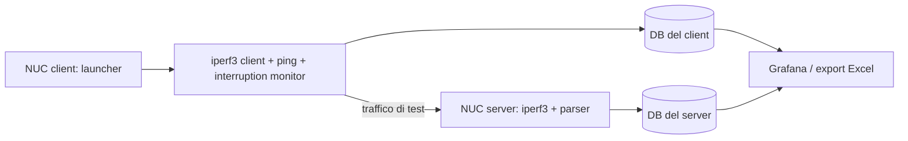

# Contesto del progetto Network Monitor v2

Documento di orientamento per collaboratori e agenti, aggiornato il **9 novembre 2026** leggendo codice e documentazione locali. Non equivale a una verifica corrente della rete. Per interventi e prove del 5 novembre vedere il [passaggio di consegne NUC/INDRA](HANDOVER_NUC_PERMISSIONS_INDRA_20261105.md).

Aggiornamento infrastruttura: la [ricognizione management del 9 novembre](MANAGEMENT_INVENTORY_20261109.md) ha identificato InfluxDB **2.7.12 su 10.10.27.41:8086**, LibreNMS su NUC2 e i monitor Blu Wireless su .70–74. **Successivamente, su richiesta dell'utente, NUC2 è stato migrato a una nuova istanza locale InfluxDB 2.7.12.** NUC1 e LibreNMS restano su MariaDB; lo storico è conservato. Leggere [la migrazione InfluxDB](INFLUXDB_MIGRATION.md) per stato attuale, nuove componenti, test, accesso e rollback. Le sezioni seguenti descrivono anche l'architettura originaria MariaDB.

## Scopo e contesto operativo

Network Monitor v2 è uno strumento COMSA per generare traffico e misurare le prestazioni di rete tra due host Debian/Ubuntu. È usato nel contesto del progetto FuTuRe, con prove su NUC1 e NUC2 attraverso percorsi gateway CEIT/INDRA e bypass. Nella richiesta di assistenza Jaime attribuisce il tool a FuTuRe 1, Task 9.8, ma tale riferimento contrattuale non è stato verificato: non usarlo come dato ufficiale senza riscontro.

Il tool combina generazione UDP/TCP tramite iperf3, misura della latenza tramite ping, rilevamento delle interruzioni, persistenza in MariaDB o InfluxDB 2, dashboard Grafana ed esportazione Excel. I risultati servono a confrontare percorsi, direzioni e parametri di traffico, e a preparare report delle campagne.

Persone emerse nella richiesta: Luca per COMSA, Xavi come interlocutore che ha inoltrato la segnalazione, Jaime Resuela Bajo per INDRA. Il repository non costituisce un'anagrafica completa del progetto. Non inviare comunicazioni per loro conto senza istruzione esplicita.

## Architettura e flusso dei dati



- **Ogni host scrive solo nel DB configurato per quel nodo.** Non c'è sincronizzazione host-to-host o scrittura nel DB del peer da parte del runtime.
- Le dashboard miste leggono DB locale e remoto tramite datasource distinti. L'export può leggere opzionalmente anche il DB remoto per affiancare le misure.
- La modalità server conserva i propri campioni iperf; il client avvia anche ping e monitor delle interruzioni.
- `--reverse` mantiene i ruoli di controllo client/server, ma inverte il verso del traffico iperf. Il DB del client resta quello del nodo che ha lanciato il client.
- Il server iperf UDP richiede comunque una connessione TCP di controllo sulla porta selezionata. Un rifiuto TCP può quindi impedire anche una prova UDP.

## Mappa del codice

| File/cartella | Responsabilità |
|---|---|
| `network_monitor/server_launcher.sh` | Entry point, lettura configurazione, CLI, selezione server/client/export, avvio e pulizia dei processi |
| `network_monitor/iperf_client.sh` | Costruzione comandi iperf3, modalità client/server, parsing degli intervalli, inserimenti e metadata nel DB |
| `network_monitor/ping_client.sh` | Raccolta e persistenza della latenza |
| `network_monitor/interruption_monitor.sh` | Rilevamento disconnessioni e recupero; soglie attuali di 5 fallimenti e 3 successi consecutivi |
| `network_monitor/export_excel.py` | Lettura dei dati e generazione workbook, filtri temporali e affiancamento remoto opzionale |
| `network_monitor/setup.conf.example` | Esempio configurazione senza segreti reali |
| `setup_v2.sh` | Installazione v2, dipendenze, schema/migrazioni DB, virtualenv e comando di sistema |
| `setup.sh`, `setup_DB.sh` | Script distinti dal setup v2; esaminare prima di usarli, non trattarli come equivalenti |
| `network_monitor/grafana_dashboards/` | Dashboard JSON locale e locale/remoto |
| `docker/`, `docker-compose.grafana.yml` | Avvio e provisioning opzionale di Grafana |
| `run_kpi_tests.sh` | Wrapper della campagna CEIT/bypass |
| `tests/scripts/` | Campagne, riepiloghi, report e conversioni PDF |
| `tests/helpers/` | Helper/mock per i test |
| `scripts/grant_runtime_access.sh` | Correzione ACL per l'utente runtime, introdotta durante l'assistenza del 5 novembre |
| `network_monitor/storage.sh`, `influx_store.py` | Selezione backend e scrittura/lettura HTTP InfluxDB 2 |
| `scripts/install_influxdb2.sh`, `scripts/provision_influxdb2.py` | Installazione locale, bucket, token, backup e provisioning Grafana |

## Installazione e separazione workspace/runtime

Il workspace noto è `/home/comsa/network_monitor_v2` su NUC2. L'installazione eseguita dagli utenti è separata:

```text
/usr/local/bin/network_monitor2 -> /opt/network_monitor2/server_launcher.sh
/opt/network_monitor2/setup.conf
/opt/network_monitor2/.venv/
```

**Modificare il repository non aggiorna automaticamente `/opt` né NUC1.** Dopo una modifica runtime va pianificata la distribuzione su entrambi i nodi, preservando le configurazioni locali, e vanno confrontate le versioni realmente eseguite.

`sudo bash ./setup_v2.sh` installa le dipendenze iperf3, client MySQL, ping, procps/coreutils e Python venv; copia gli script, prepara DB/schema e installa le dipendenze Python. L'unica dipendenza dichiarata in `requirements.txt` è `openpyxl>=3.0,<4` per Excel. I tool di report delle campagne possono avere requisiti ulteriori: il launcher KPI verifica anche Pillow per il PDF.

Il setup v2 usa `/opt/network_monitor2` e il comando `network_monitor2`, per coesistere con una precedente installazione `network_monitor`. Non rilanciare un setup completo come tentativo generico di riparazione: può modificare configurazione, DB, pacchetti e installazione.

La configurazione è codice shell caricato con `source` e contiene credenziali DB. Mantenerla protetta e non inserirla nei log. L'installer la assegna a root e al gruppo dell'utente che installa, con modo 640. L'accesso di `tuser` è stato risolto separatamente tramite ACL; non gli sono stati concessi privilegi sudo.

## Uso e parametri essenziali

```bash
# Sul nodo server, usando un suo indirizzo locale:
network_monitor2 --server --bind-ip <IP_SERVER> --port 5050

# Sul nodo client:
network_monitor2 <IP_SERVER> --source-ip <IP_CLIENT> --port 5050 \
  --udp --bandwidth 1M --packet-size 1200 --duration 5
```

Opzioni: `--tcp`, `--reverse`, `--flows` (1–32), `--window-size`, `--interface`, oltre a quelle sopra. I default attuali documentati sono UDP, porta 5050, durata 30 s, banda UDP 100M, un flusso e packet size 1460. Per una semplice verifica impostare esplicitamente banda e durata basse, invece di affidarsi ai default.

`--packet-size` corrisponde al datagramma UDP (`iperf3 -l`) oppure all'MSS TCP (`iperf3 -M`), non alla medesima grandezza fisica nei due protocolli. `--window-size` riguarda i buffer TCP. `--source-ip` e `--bind-ip` selezionano gli endpoint: verificare comunque il risultato di `ip route get` sui due nodi. Non esistono alias CLI spagnoli `--servidor` o `--puerto`.

## Dati e contratti da preservare

Tabelle logiche: `iperf_results`, `ping_results`, `interruptions`. I nomi fisici sono configurabili con `IPERF_TABLE`, `PING_TABLE`, `INTERRUPTIONS_TABLE`; il setup può creare viste di compatibilità quando possibile.

I campioni iperf includono timestamp, bitrate, jitter, percentuale di perdita e, sullo schema esteso, `executed_command`, `protocol`, `packet_size`, `window_size`. Il campo `executed_command` veicola metadata per distinguere endpoint, protocollo, direzione, porta, flussi e parametri. Non cambiare unità, semantica o metadata senza verificare parser, DB, export e dashboard insieme.

Il contratto descritto in [protocol_metadata_spec.md](protocol_metadata_spec.md) richiede che `protocol` sia `udp` o `tcp` e coerente con `protocol=...` nei metadata. Il server deve inferire il protocollo per campione dall'output iperf, anziché assumere quello iniziale del processo server. Il parsing deve distinguere intervalli e riepiloghi, flussi singoli e aggregati e, in UDP reverse, receiver locale e sezione `Server output:`.

Export:

```bash
network_monitor2 --export-excel risultati.xlsx \
  --start "2026-11-05 14:00:00" --end "2026-11-05 14:10:00"
```

Con entrambi i limiti, il nome include automaticamente l'intervallo senza duplicare un suffisso già presente. Workbook documentato: fogli `iperf_results`, `ping_results`, `interruptions`, `commands`. Le opzioni `REMOTE_DB_*` permettono una lettura remota aggiuntiva, idealmente con account read-only. Non confonderla con scritture remote del runtime.

## Campagne: due strumenti differenti

| Campagna | Entry point | Ambito e output |
|---|---|---|
| KPI CEIT/bypass | `./run_kpi_tests.sh` | CEIT, bypass TN0, bypass TN1; report sotto `results/`; selezione route e ripristino dello stato iniziale previsti dallo script |
| Misure base Cedex | `tests/scripts/run_nuc2_base_measurements.sh` | VLAN28/29; default 54 casi: 48 UDP e 6 TCP; log sotto `tests/logs/`, export e report sotto `export/` |

Entrambi supportano `--dry-run` per ispezionare il piano senza generare traffico. Non lanciare campagne complete soltanto per orientarsi: possono durare a lungo e, per la campagna gateway, cambiare route e richiedere sudo. La campagna KPI attuale **non comprende INDRA**. Le radio interne selezionate da CEIT non sono osservabili/controllabili dai soli NUC.

La matrice Cedex nel codice corrente usa UDP/TCP, packet size 500/1000/1460 e, per UDP, otto bande da 1M a 1G su due percorsi. Durata predefinita 120 s e pausa 20 s per caso: verificare sempre il blocco di configurazione prima di eseguire.

## Rete di laboratorio e stato noto

Management: NUC1 `10.10.27.10`, NUC2 `10.10.27.11`, rete direttamente connessa su `enp114s0`. Gateway test: NUC1 `10.10.22.10`, NUC2 `10.10.42.11`. Bypass: VLAN28 `.28.10/.28.11` e VLAN29 `.29.10/.29.11`.

CEIT e INDRA usano gli stessi endpoint test ma next hop diversi: CEIT `.22.40/.42.41`, INDRA `.22.30/.42.31`. Gli script di selezione installati sono `/home/tuser/scripts/test_ceit` e `test_indra` sui due host. La route di andata e quella di ritorno devono essere coerenti; mantenere intatta la management per non perdere l'accesso.

Stato verificato il 5 novembre: permessi corretti, runtime come `tuser` funzionante in entrambi i versi sulla management e DB aggiornati; percorso INDRA ancora guasto. Non estendere quel risultato al resto della rete e non presumere che lo stato runtime sia immutato oggi. Prove dettagliate, vincoli e prossimi passi sono nel [documento di handover](HANDOVER_NUC_PERMISSIONS_INDRA_20261105.md).

## Verifica delle modifiche

Scegliere verifiche proporzionate al cambiamento:

- `bash -n <script>` per ciascuno script shell modificato.
- `bash tests/test_network_monitor_options.sh` per CLI, argomenti iperf, parsing e metadata: usa helper/mock DB e traffico loopback, non è una prova del DB reale né della rete gateway.
- `bash tests/test_base_measurement_matrix.sh` per la matrice dry-run Cedex.
- `python3 tests/test_export_filename.py` per naming e intervalli export, con le dipendenze Python disponibili.
- Per un intervento sui dispositivi: verificare file installati, utente runtime, listener, traffico limitato, righe DB e chiusura dei soli processi creati per il test.

Non basta un ping positivo per attestare l'endpoint corretto, né l'help del launcher per attestare DB e generazione traffico. Nell'incidente INDRA è stato necessario confrontare catture simultanee e usare una prova positiva sulla management.

Le suite e il test live InfluxDB sono stati successivamente rieseguiti prima del commit, insieme a una prova UDP/reverse/TCP fra i NUC: vedere [VALIDATION_20261109.md](VALIDATION_20261109.md) per comandi, risultati e limiti. Non è stata lanciata una campagna KPI completa.

## Orientamento per un nuovo agente

1. Leggere questo documento, poi [README](../README.md), [guida operativa](network_monitor_guide/GUIDA_NETWORK_MONITOR.md) e [handover NUC](HANDOVER_NUC_PERMISSIONS_INDRA_20261105.md).
2. Controllare `git status` prima di intervenire. Esistono modifiche locali preesistenti al parser UDP reverse e al relativo test, descritte nell'handover: preservarle.
3. Distinguere richiesta sul codice, distribuzione su `/opt`, installazione e intervento sulla rete: non sono la stessa operazione.
4. Verificare lo stato vivo dei dispositivi prima di usare risultati storici come premessa.
5. Aggiornare i documenti con fatti, date e limiti delle prove; non attribuire diagnosi certe ai gateway senza accesso o catture sufficienti.

**Trasferibilità:** `.gitignore` esclude `results*`, `export/`, `*.log`, `setup*` e `docs/kpi_campaign`. Alcuni file già tracciati possono comunque essere presenti: usare `git ls-files` per distinguere contenuti versionati da risorse solo locali. Non affidarsi a una clonazione per trasferire risultati, configurazioni o tutti i documenti storici. I documenti di contesto e validazione in `docs/` sono inclusi nella pubblicazione della migrazione; log e segreti restano esclusi. Consultare `git log -1` e `git status -sb` per versione e sincronizzazione remota.
